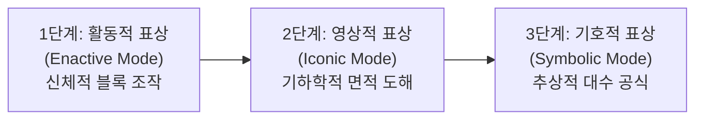

# 📐 Bruner Math Lab - 이항정리의 시각적·대수적 이해 `(a+b)²`

> **제롬 브루너(Jerome S. Bruner)의 인지 표상 양식 이론**에 철저히 입각하여 제작된 인터랙티브 수학교육 웹 애플리케이션입니다.  
> 중학교 수학의 핵심 주제인 **곱셈 공식과 이항정리 $(a+b)^2 = a^2 + 2ab + b^2$**을 활동적(Enactive) → 영상적(Iconic) → 기호적(Symbolic) 3단계를 거치며 완벽하게 내면화할 수 있도록 지원합니다.

🌐 **웹에서 바로 실행하기 (Live Demo):**  
👉 **[https://creator-yeman.github.io/Bruner-math-app/](https://creator-yeman.github.io/Bruner-math-app/)**

📑 **수업실연 현장용 실전 큐시트 (누구나 바로 열람 & A4 인쇄 가능):**  
👉 **[https://creator-yeman.github.io/Bruner-math-app/cuesheet.html](https://creator-yeman.github.io/Bruner-math-app/cuesheet.html)**

---

## 🎯 교육적 목표 및 브루너의 3단계 인지 발달 모델



### 1️⃣ 1단계: 활동적 표상 (Enactive - 구체적 조작)
* **신체적 조작과 촉각적 경험:** $a \times a$, $b \times a$, $a \times b$, $b \times b$ 4개의 블록을 목표 정사각형 틀에 마우스/터치로 직접 드래그 앤 드롭(또는 탭)하여 빈틈없이 채웁니다.
* **오개념 타파 실험기:** 중학생이 흔히 범하는 `(a+b)² = a² + b²` 오개념을 직접 실험합니다. $a^2$과 $b^2$만 넣었을 때 두 개의 직사각형 구멍($2ab$)이 텅 비어 있는 현상을 목격하며 $2ab$의 필연성을 체득합니다.
* **자석 스냅 & 사운드 피드백:** 웹 오디오 기반의 기분 좋은 스냅 효과음과 완성 축하 애니메이션을 제공합니다.

### 2️⃣ 2단계: 영상적 표상 (Iconic - 시각적 심상)
* **시각적 심상 형성:** 구체물이 없어도 머릿속에 공간적 구조를 그릴 수 있도록 4개 영역($a^2, ba, ab, b^2$)이 색상별로 구분된 기하학적 도해로 전환됩니다.
* **조각 분해하여 보기 (Exploded View):** 4개의 조각이 사방으로 분해되었다가 다시 하나의 정사각형으로 합쳐지는 뷰를 통해 전체와 부분의 관계를 시각화합니다.
* **단위 격자 (1×1 눈금):** 1단위 격자를 켜서 학생들이 실제 격자 개수를 직접 세어보며 넓이를 검증할 수 있습니다.
* **인터랙티브 영역 검사기:** 영역별 가로, 세로, 넓이 공식($가로 \times 세로$)이 실시간으로 하이라이트됩니다.

### 3️⃣ 3단계: 기호적 표상 (Symbolic - 추상적 기호와 공식)
* **형식적 대수화:** 시각적 면적 경험을 바탕으로 $(a+b)^2 = a^2 + 2ab + b^2$ 공식의 분배법칙 및 동류항 정리 과정을 5단계로 체계화합니다.
* **실시간 수치 동기화 계산기:** 슬라이더로 $a$와 $b$ 값을 바꾸면 좌변과 우변의 모든 계산 과정이 실시간 동기화되어 항등식임을 확인합니다.
* **실생활 암산 마법:** $52^2 = (50+2)^2 = 2500 + 200 + 4 = 2704$ 등 큰 수의 제곱을 순식간에 계산하는 곱셈 공식의 실생활 활용 팁을 소개합니다.
* **나만의 공식 발견 체크 퀴즈 & 마스터 인증서:** 중학 교육과정에 최적화된 형성평가 4문항을 통과하면 마스터 인증서가 수여됩니다.

---

## 💻 기술 스택 및 기능

- **프론트엔드:** 단일 파일 순수 웹 앱 (HTML5, Vanilla JavaScript)
- **스타일링:** Tailwind CSS
- **수식 렌더링:** KaTeX (LaTeX 수식 타이포그래피)
- **아이콘:** Lucide Icons
- **음향 효과:** Web Audio API 자체 신디사이저 (외부 오디오 파일 없이 오프라인 구동)
- **인터랙션:** Canvas-Confetti, CSS 3D 하드웨어 가속 드래그 앤 드롭
- **특화 모드:** 
  - 🏫 **교사용 칠판/프로젝터 모드:** 교실 빔프로젝터 및 전자칠판 시인성을 위한 115% 대형 폰트와 고대비 칠판 테마 토글
  - 🔊 **효과음 On/Off 토글**

---

## 🚀 로컬 실행 방법

별도의 빌드 과정(Node.js / npm 등) 없이 브라우저에서 바로 열 수 있습니다.

1. 저장소를 클론합니다:
   ```bash
   git clone https://github.com/Creator-Yeman/Bruner-math-app.git
   ```
2. 폴더 내의 `index.html` 파일을 더블 클릭하여 Chrome, Edge, Safari 등의 웹 브라우저에서 실행합니다.

---

## 📜 라이선스
MIT License
